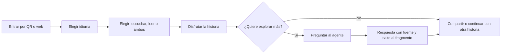
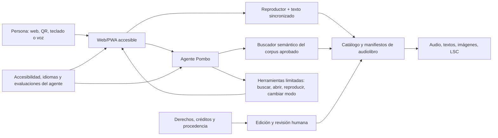
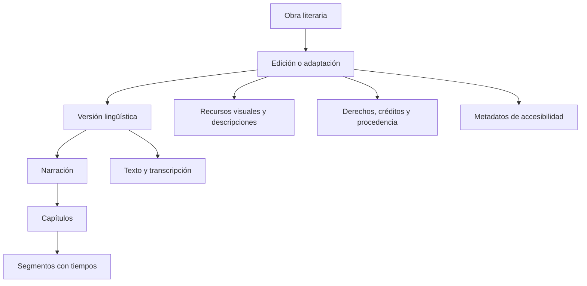

# Pombo — Plan maestro de producto web

**Fecha:** 16 de octubre de 2026  
**Versión:** 0.2  
**Estado:** propuesta mejorada para conversación y validación  
**Objetivo:** definir antes de construir una web de audiolibros multilingüe, inclusiva y agéntica conectada con el universo artístico de Pombo.

> **Corte de implementación actual (16 de octubre de 2026):** la web conserva una lectura sencilla y ahora documenta las seis piezas de la serie escultórica: cinco personajes con su texto fuente y una ficha de Rafael Pombo con anexo bibliográfico. La interfaz ES/EN, la procedencia y las preferencias de lectura siguen siendo esenciales. No se publican todavía traducciones, narración oficial, LSC ni agente. Esos elementos permanecen como fases posteriores y sólo deben entrar después de revisión editorial y pruebas con personas usuarias.

## 0. Resumen ejecutivo

**Pombo** será una experiencia cultural web, pública y accesible que une las historias de Rafael Pombo, las seis esculturas, audiolibros multilingües y un agente de mediación. Una persona podrá llegar desde un QR o desde Internet, elegir idioma y modalidad, escuchar o leer una obra y conversar con fuentes verificables sobre el relato, el personaje, la escultura y su contexto.

La recomendación es construir primero **una historia completa y excelente**, probarla con usuarios diversos y solo después escalar contenidos, idiomas y autonomía del agente.

### Decisiones recomendadas para el MVP

| Decisión | Recomendación |
|---|---|
| Nombre público | **Pombo** |
| Primera entrega | Una historia/personaje de principio a fin |
| Idiomas | Español de Colombia (`es-CO`) e inglés (`en`) |
| Acceso | Gratuito, sin cuenta y preparado para QR |
| Narración | Voz humana como edición canónica |
| Accesibilidad | WCAG 2.2 AA + pruebas con personas con discapacidad |
| Modalidades | Escuchar, leer, leer+escuchar, transcripción y lectura fácil |
| LSC | Piloto co-producido, no traducción automática |
| Agente | Guía de solo lectura, con fuentes y herramientas limitadas |
| Datos | Privacidad por defecto; preferencias locales u opt-in |

### Resultado esperado del MVP

Una persona debe poder completar sin ayuda estas cuatro tareas:

1. encontrar una historia en su idioma;
2. escucharla o leerla usando la modalidad que prefiera;
3. comprender quién habla, qué está ocurriendo y cómo se relaciona con Pombo;
4. hacer una pregunta y recibir una respuesta verificable que la lleve al fragmento correspondiente.

## 1. Qué debería ser

**Pombo** sería una biblioteca narrativa pública donde cada persona pueda **escuchar, leer, seguir el texto, explorar y conversar** con las historias y esculturas de Pombo en el idioma y la modalidad que mejor le funcionen.

No sería simplemente una página con archivos de audio ni un chatbot agregado al final. Sería una **publicación digital accesible** con un agente que trabaja únicamente sobre un corpus cultural aprobado y que ayuda a la persona a encontrar, comprender y experimentar la obra.

### Promesa de producto

> “Puedo entrar sin registrarme, elegir mi idioma y mi forma de acceso, disfrutar una historia completa y preguntarle a Pombo sobre lo que acabo de escuchar sin perder el control de la experiencia.”

### Relación con la obra física

- Cada una de las seis esculturas puede conducir mediante URL o QR a su historia.
- La experiencia debe funcionar también fuera del espacio expositivo.
- El sitio puede explicar personaje, relato, escultura, proceso material y contexto bogotano.
- La mediación digital amplía la obra; no debe ser obligatoria para comprenderla.

### Recorrido principal de una persona

El selector de accesibilidad no debe preguntar “¿qué discapacidad tienes?”. Debe ofrecer preferencias funcionales: tamaño y espaciado del texto, contraste, velocidad, reducción de movimiento, transcripción, lectura fácil, audio, teclado y LSC cuando esté disponible.

## 2. A quién sirve

El producto debe diseñarse con personas reales, no con una “persona promedio”. Los grupos prioritarios son:

- niñas, niños, familias y docentes;
- visitantes de Bogotá que hablan español u otros idiomas;
- personas ciegas o con baja visión;
- personas sordas o hipoacúsicas;
- personas con dislexia, discapacidad cognitiva o diferentes ritmos de lectura;
- personas con movilidad reducida que usan teclado, voz o dispositivos alternativos;
- personas mayores;
- usuarios con teléfonos básicos, conexión lenta o datos limitados.

La primera versión no puede resolver toda la diversidad, pero su arquitectura no debe excluirla.

## 3. Principios no negociables

1. **Acceso sin cuenta:** escuchar y leer no exige registro.
2. **Equivalencia de modalidades:** audio, texto y navegación ofrecen la misma información esencial.
3. **Humano antes que automatización:** traducciones, narraciones y publicaciones canónicas tienen revisión humana.
4. **IA identificable:** toda voz, traducción, resumen o explicación generada por IA se etiqueta claramente.
5. **El agente no reemplaza la interfaz:** reproducción, idioma, capítulos y accesibilidad siempre tienen controles visibles.
6. **Privacidad mínima:** no inferir ni almacenar diagnósticos de discapacidad; recordar preferencias solo con consentimiento.
7. **Procedencia:** cada texto, traducción, voz, imagen y modelo tiene autoría, licencia, versión y fecha.
8. **Bajo ancho de banda:** páginas livianas, audio por capítulos y descarga opcional cuando los derechos lo permitan.
9. **Diseño con la comunidad:** personas con discapacidad y hablantes de los idiomas participan desde el prototipo.
10. **Conservación:** los originales de audio, textos, sincronizaciones y metadatos quedan en formatos abiertos y exportables.

## 4. Modalidades de experiencia

Cada historia debería poder ofrecer, según disponibilidad:

| Modalidad | Para qué sirve |
|---|---|
| Escuchar | Narración humana completa, capítulos, velocidad y temporizador |
| Leer | Texto adaptable, semántico y compatible con lector de pantalla |
| Leer y escuchar | Texto resaltado de forma sincronizada con el audio |
| Lectura fácil | Resumen y adaptación de comprensión, claramente diferenciados del original |
| Transcripción | Equivalente completo del audio, incluidos sonidos relevantes |
| Lengua de Señas Colombiana | Video interpretado para contenidos priorizados, producido con personas expertas |
| Descripción de imágenes | Alternativas breves o extendidas para ilustraciones, esculturas y material visual |
| Descarga/offline | Historia disponible sin conexión, sujeta a derechos |
| Conversar | Preguntas por texto o voz con respuestas basadas en fuentes aprobadas |

## 5. Alcance recomendado del primer piloto

Construir primero **una historia verticalmente completa**, no seis historias incompletas.

### Piloto recomendado

- Una historia/personaje de Pombo, escogida por disponibilidad de texto, imágenes y relación con una escultura.
- Interfaz en `es-CO` e inglés.
- Texto original/aprobado y traducción revisada por una persona bilingüe con criterio literario.
- Narración humana en español e inglés para que ambas ediciones tengan una experiencia canónica equivalente.
- Texto y audio sincronizados por párrafo o frase.
- Transcripción completa y versión de lectura fácil en español.
- Introducción corta en Lengua de Señas Colombiana como prueba de método, no como traducción automática.
- Agente de texto de alcance limitado; voz conversacional como segunda iteración.
- Acceso por QR, móvil y escritorio; funcionamiento básico sin iniciar sesión.

### Prioridades del MVP

| Prioridad | Capacidades |
|---|---|
| **P0 — obligatorio** | Inicio y catálogo; página de historia; selector español/inglés; reproductor accesible; texto completo; transcripción; sincronización; créditos/derechos; aviso de accesibilidad; QR; comentarios de accesibilidad; agente textual con fuentes |
| **P1 — deseable** | Lectura fácil; modo offline; descripción extendida de esculturas; narración humana en ambos idiomas; actividades pedagógicas; preferencias locales |
| **P2 — después de validar** | Conversación por voz; LSC para la historia completa; cuentas; progreso entre dispositivos; más idiomas; recorridos geolocalizados; exportación EPUB completa |

### Definición de “piloto terminado”

El piloto no se considera terminado por estar publicado. Debe cumplir simultáneamente:

- contenido y derechos aprobados;
- audio, texto, traducción y sincronización verificados por personas;
- tareas principales posibles con teclado y lector de pantalla;
- experiencia comprensible a 400 % de zoom y en móvil;
- prueba con al menos cinco perfiles de acceso diferentes, sin generalizar sus resultados a toda la población;
- agente evaluado con preguntas conocidas, ambiguas, fuera de alcance y maliciosas;
- plan de corrección, responsable y fecha para cada barrera abierta;
- copia de preservación y posibilidad de reconstruir la publicación.

### Lo que no entra en el primer piloto

- Traducción automática publicada sin revisión.
- Clonación de voces.
- Red social, comentarios públicos o perfiles infantiles.
- Compras, suscripciones o DRM.
- Agente con acceso abierto a Internet.
- Generación ilimitada de nuevas versiones del cuento.
- Seis idiomas antes de validar el flujo completo con dos.

## 6. Arquitectura conceptual

### Capas

1. **Web/PWA:** HTML semántico, renderizado rápido, rutas por idioma y mejora progresiva.
2. **Catálogo:** obras, ediciones, idiomas, narraciones, capítulos, segmentos y derechos.
3. **Medios:** originales preservables y derivados optimizados para web.
4. **Publicación:** flujo editorial con borrador, revisión, aprobación y publicación.
5. **Agente:** recuperación sobre contenido aprobado, herramientas acotadas, guardrails y trazas.
6. **Evaluación:** pruebas automáticas, auditoría manual y sesiones con usuarios.

La tecnología concreta puede elegirse después del piloto de contenido. Una opción razonable es una aplicación web TypeScript con renderizado del servidor, almacenamiento de objetos para audio, PostgreSQL para catálogo y un CMS desacoplado; el modelo de contenido debe ser portable para no quedar atado a un proveedor.

### Mapa mínimo de la web

| Espacio | Propósito |
|---|---|
| Inicio | Presentar Pombo y ofrecer acceso directo por idioma y modalidad |
| Historias | Catálogo filtrable por personaje, idioma, duración y modalidades disponibles |
| Historia | Reunir portada, contexto, reproductor, texto, capítulos, accesibilidad y créditos |
| Esculturas | Relacionar cada obra física con su personaje, proceso e historia |
| Pregúntale a Pombo | Conversación por texto con fuentes y acciones sobre el reproductor |
| Para aprender | Actividades verificadas para familias y docentes |
| Sobre Pombo | Intención artística, proceso New Media Art AI-DLC y equipo |
| Accesibilidad | Capacidades, limitaciones conocidas, atajos y canal de comentarios |
| Derechos y créditos | Autoría, traducciones, voces, licencias y procedencia |

La zona editorial será privada y separada de la experiencia pública. Publicar o retirar contenido siempre será una acción humana autenticada.

## 7. Modelo de contenido multilingüe

La unidad principal no debe ser “una página traducida”, sino una cadena versionada:

Campos mínimos:

- identificador estable y versión;
- título, autor, adaptación, traducción y narración;
- idioma mediante etiqueta BCP 47 (`es-CO`, `en`, `pt-BR`, etc.);
- dirección de escritura y progresión de lectura;
- capítulos, orden de lectura y duración;
- texto completo y marcas de tiempo;
- resumen, nivel de lectura y vocabulario;
- características y riesgos de accesibilidad;
- licencia de cada activo y fecha de autorización;
- estado editorial: borrador, revisado, aprobado o retirado;
- hash del archivo maestro y fecha de publicación.

Cada edición debe poder exportar un **W3C Audiobook Manifest en JSON-LD**. Si más adelante se distribuye como EPUB 3, la misma sincronización puede producir Media Overlays.

## 8. Método multilingüe

### Arquitectura

- UTF-8 de extremo a extremo.
- `lang` correcto en página y en fragmentos que cambian de idioma.
- URLs estables como `/es-co/historias/rin-rin/` y `/en/stories/rin-rin/`.
- selector visible con el nombre nativo del idioma; nunca depender solo de banderas.
- detección inicial por preferencias del navegador, siempre reversible por la persona.
- recordar la selección explícita sin forzarla en enlaces compartidos.
- soporte preparado para escritura de derecha a izquierda aunque no sea parte del MVP.
- búsqueda por idioma, sin mezclar resultados o respuestas inadvertidamente.

### Flujo editorial por idioma

1. Congelar el texto fuente y registrar su procedencia.
2. Crear glosario de personajes, topónimos, rimas y decisiones de tono.
3. Traducir; la IA puede producir un borrador, no la versión publicada.
4. Revisión por traductor/editor humano y, cuando corresponda, hablantes de la comunidad.
5. Lectura en voz alta y control de ritmo, rima, referencias culturales y pronunciación.
6. Grabar o generar audio autorizado.
7. Alinear texto y audio.
8. Revisión lingüística, auditiva y de accesibilidad.
9. Aprobar y publicar una versión identificable.

Para lenguas indígenas o comunitarias, el trabajo debe ser de coautoría y consentimiento con sus hablantes; no debe reducirse a traducción automática.

## 9. Método de producción de audio

1. Guion aprobado con notas de pronunciación y sonidos relevantes.
2. Contrato y consentimiento de narrador, traductor, intérprete y productor.
3. Grabación maestra sin compresión; conservar WAVE/BWF con metadatos.
4. Edición, limpieza y normalización coherente de volumen en toda la colección.
5. Revisión humana de nombres, ritmo, inteligibilidad y ausencia de artefactos.
6. Exportación de derivados web por capítulo.
7. Transcripción verificada y segmentación temporal.
8. Manifiesto, créditos, licencia, checksum y copia de preservación.

La voz humana debe ser la referencia canónica. Una voz sintética puede usarse para prototipos, lectura bajo demanda o respuestas breves del agente, siempre señalada como artificial y con permiso para cualquier voz personalizada.

## 10. Qué significa “agéntica” aquí

El agente no es una mascota que conversa sin propósito. Es un **mediador cultural accesible** capaz de comprender una intención, consultar el archivo de Pombo, usar herramientas limitadas y acompañar una tarea hasta completarla.

### Escalera de autonomía

| Nivel | Comportamiento | Momento |
|---|---|---|
| 0 — Publicación | Catálogo, reproductor y búsqueda convencional | Base obligatoria |
| 1 — Guía | Responde, cita, abre y controla la presentación sin guardar datos | **MVP** |
| 2 — Acompañante | Recuerda preferencias consentidas y propone recorridos o aprendizaje | Después de la beta |
| 3 — Asistente editorial | Prepara borradores, alineaciones o informes para revisión humana | Herramienta interna separada |
| 4 — Publicación autónoma | Modifica o publica contenido por sí mismo | **No permitido** |

Esta escalera evita que “agéntico” signifique autonomía ilimitada. El MVP se queda deliberadamente en el nivel 1.

### Contrato de cada respuesta

1. Responder en el idioma y nivel de claridad solicitados.
2. Distinguir texto original, interpretación editorial y contenido generado.
3. Mostrar la fuente aprobada o explicar que no existe evidencia suficiente.
4. Ofrecer una acción útil y reversible: abrir, escuchar, comparar o explicar.
5. No cambiar preferencias persistentes ni enviar datos sin consentimiento.

### Capacidades iniciales

- encontrar una historia por personaje, tema, duración, edad orientativa o idioma;
- responder preguntas citando el texto, la ficha de la obra o la memoria de Pombo;
- abrir el capítulo pertinente y llevar el reproductor al fragmento citado;
- explicar una palabra o pasaje con lenguaje más sencillo;
- comparar traducciones aprobadas;
- crear una guía de escucha o actividad pedagógica, marcada como generada;
- cambiar idioma, velocidad, tamaño del texto o modo de lectura cuando la persona lo pida;
- continuar desde el último punto solo si la persona acepta guardar esa preferencia.

### Herramientas permitidas

- `search_catalog`
- `get_approved_passage`
- `open_story_or_chapter`
- `seek_player`
- `set_language`
- `set_accessibility_preferences`
- `create_ephemeral_summary_or_activity`
- `send_accessibility_feedback`

### Límites

- El agente responde primero desde el corpus aprobado y muestra la fuente.
- Si no encuentra evidencia, dice que no lo sabe; no completa la historia inventando hechos.
- No publica traducciones, modifica textos canónicos ni cambia derechos.
- No identifica ni diagnostica discapacidades.
- No conserva conversaciones o voz por defecto.
- No navega por Internet en la experiencia infantil.
- Toda acción que guarde datos, envíe información o publique contenido requiere consentimiento o revisión humana.
- Las respuestas para menores evitan perfiles, publicidad y persuasión comercial.

Para el piloto conviene una arquitectura de voz encadenada —voz a texto, agente, texto a voz— porque permite inspeccionar la transcripción, aplicar políticas y evaluar cada etapa. La conversación de voz en tiempo real puede añadirse cuando el agente de texto ya sea fiable.

## 11. Accesibilidad: definición de terminado

Objetivo técnico: **WCAG 2.2 nivel AA**, además de las directrices cognitivas y de medios pertinentes. Si la web queda dentro de una entidad obligada en Colombia, debe verificarse además la Resolución MinTIC 1519 de 2020.

### Método de co-diseño

La conformidad técnica y las pruebas con personas cumplen funciones diferentes y ambas son necesarias. Se recomienda formar un pequeño panel remunerado que participe en prototipos sucesivos, incluyendo experiencias de acceso diversas; ninguna persona debe ser tratada como representante de toda una discapacidad.

| Necesidad de acceso | Qué se valida en tareas reales |
|---|---|
| Ceguera/baja visión | Estructura, nombres, controles, descripciones y reproductor con lector de pantalla o magnificación |
| Sordera/hipoacusia | Equivalencia de transcripción, sonidos significativos, claridad de LSC y control visual |
| Movilidad | Teclado, voz, pulsadores, orden de foco y tamaño de objetivos |
| Cognición/dislexia | Lenguaje claro, lectura fácil, previsibilidad, ritmo y carga de opciones |
| Infancia/personas mayores | Comprensión, confianza, recuperación de errores y ausencia de patrones engañosos |
| Conectividad limitada | Peso, tiempo de inicio, reanudación, descarga y degradación sin funciones secundarias |

Las sesiones deben observar tareas, no preguntar únicamente si “les gustó”. Cada hallazgo se registra con evidencia, severidad, responsable y fecha de corrección.

### Interfaz y navegación

- HTML nativo y landmarks correctos;
- funcionamiento completo con teclado;
- foco visible, orden lógico y salto al contenido;
- controles con nombre, rol, valor y objetivos de al menos 24 × 24 CSS px;
- zoom/reflow al 400 % sin pérdida de operación;
- contraste AA, modo de alto contraste y ausencia de significado solo por color;
- respeto por `prefers-reduced-motion`;
- mensajes dinámicos anunciados sin interrumpir la narración;
- títulos, encabezados y enlaces descriptivos;
- errores comprensibles y recuperables.

### Reproductor

- reproducir/pausar, avanzar/retroceder, capítulo, volumen y velocidad mediante teclado;
- estado del reproductor comprensible por lector de pantalla;
- no reproducir automáticamente;
- no cambiar de capítulo o idioma sin anunciarlo;
- transcripción navegable e interactiva;
- texto sincronizado que no obligue a seguir el movimiento visual;
- posición, preferencias y descargas bajo control de la persona.

### Contenido

- transcripción equivalente para todo audio pregrabado;
- texto alternativo y descripción larga cuando una imagen lo requiera;
- lenguaje claro, frases breves y resúmenes para contenido complejo;
- lectura fácil creada y revisada como adaptación, no como reemplazo del original;
- LSC producida con intérprete competente para los contenidos priorizados;
- información de accesibilidad visible antes de abrir o descargar cada edición.

## 12. Derechos, privacidad y protección infantil

Antes de publicar debe existir una **matriz de derechos** por activo. Aunque los textos originales de Rafael Pombo probablemente estén en dominio público por la fecha de su muerte, cada edición moderna, traducción, adaptación, ilustración, fotografía, narración, música, interpretación y fonograma puede tener derechos independientes. Esto requiere verificación jurídica documental, no solo una inferencia por antigüedad.

La matriz debe registrar:

- obra fuente y edición usada;
- titular o condición de dominio público;
- permiso de traducción/adaptación;
- derechos de voz, interpretación y fonograma;
- imágenes, música y efectos;
- territorios, duración, usos y licencia de publicación;
- permiso específico para IA o clonación de voz, si alguna vez se usa;
- atribución obligatoria y evidencia del consentimiento.

Privacidad por defecto:

- acceso anónimo;
- analítica agregada y sin publicidad comportamental;
- chat efímero salvo consentimiento explícito;
- micrófono activado solo al presionar y con indicador persistente;
- política clara sobre proveedor, retención y transferencias internacionales;
- eliminación fácil de preferencias y datos;
- evaluación de impacto antes de tratar voz o datos de menores.

## 13. Plan por fases

Las duraciones son estimaciones iniciales para un equipo pequeño y deben ajustarse después de inventariar contenidos.

Si todo se ejecutara en serie, la beta del MVP tomaría aproximadamente **10–18 semanas**. Diseño, contenido e infraestructura pueden solaparse después de la Fase 0, pero derechos, contenido aprobado y pruebas con usuarios son puertas que no deben omitirse para “ganar tiempo”.

### Frentes de trabajo

| Frente | Resultado | Responsable principal sugerido |
|---|---|---|
| Dirección artística | Intención, canon, relación con esculturas y aprobación final | Julián / dirección de Pombo |
| Editorial y lenguas | Texto fuente, glosario, traducciones, lectura fácil y créditos | Editor/a + traductores/as |
| Audio y LSC | Narraciones, producción sonora, sincronización e interpretación | Productor/a de audio + equipo LSC |
| Inclusión e investigación | Co-diseño, requisitos, pruebas y seguimiento de barreras | Especialista en accesibilidad |
| Diseño de producto | Arquitectura de información, interacción y sistema visual | Diseñador/a UX/UI |
| Ingeniería web | PWA, catálogo, reproductor, CMS, rendimiento y seguridad | Desarrollo full-stack |
| Agente e IA | Recuperación, herramientas, guardrails, trazas y evaluaciones | Ingeniería de IA |
| Derechos y privacidad | Licencias, contratos, datos, menores y proveedores | Producción + asesoría jurídica |

Una persona puede cubrir más de un frente en un equipo pequeño, pero cada resultado debe tener un nombre responsable y una persona que lo apruebe.

### Fase 0 — Definición y evidencia (1–2 semanas)

**Trabajo**

- elegir audiencia prioritaria, historia piloto e idiomas;
- inventariar textos, imágenes, grabaciones y documentación Pombo;
- construir matriz de derechos y procedencia;
- entrevistar a usuarios, docentes, mediadores y especialistas;
- definir política de accesibilidad, privacidad y uso de IA;
- decidir qué significa “canónico”, “adaptado” y “generado”.

**Puerta:** un brief aprobado, corpus legalmente utilizable y criterios de éxito medibles.

### Fase 1 — Prototipo de contenido (2–4 semanas)

**Trabajo**

- preparar el texto fuente y glosario;
- traducir y revisar el idioma secundario;
- grabar audio piloto;
- producir transcripción y sincronización;
- crear lectura fácil, descripciones y muestra LSC;
- probar el flujo editorial completo sin construir aún toda la plataforma.

**Puerta:** paquete de una historia aprobado en dos idiomas y varias modalidades.

### Fase 2 — Reproductor y biblioteca accesible (3–5 semanas)

**Trabajo**

- catálogo, página de historia y navegación por idioma;
- reproductor accesible y texto sincronizado;
- manifiesto W3C de audiolibro;
- descargas/offline básicas;
- CMS o flujo editorial versionado;
- pruebas automáticas y manuales de accesibilidad.

**Puerta:** cualquier persona puede encontrar, escuchar y leer el piloto sin agente.

### Fase 3 — Agente de mediación, solo lectura (2–4 semanas)

**Trabajo**

- indexar únicamente contenido aprobado;
- respuestas con cita y enlace al fragmento;
- herramientas para buscar, abrir, reproducir y adaptar la presentación;
- guardrails, trazas, límites de sesión y aviso de IA;
- conjunto de evaluaciones multilingües y de seguridad;
- entrada por voz opcional mediante pipeline inspeccionable.

**Puerta:** el agente aporta valor sin ser necesario para usar la biblioteca y sin alterar contenidos.

### Fase 4 — Beta inclusiva (2–3 semanas)

**Trabajo**

- pruebas con lectores de pantalla, teclado, zoom, voz y conexión limitada;
- sesiones compensadas con personas ciegas, sordas, con discapacidad cognitiva, mayores, niñas/niños acompañados y hablantes de ambos idiomas;
- corregir barreras críticas;
- auditoría WCAG manual independiente;
- evaluación lingüística y cultural.

**Puerta:** cero bloqueos críticos y tareas principales completables por los grupos probados.

### Fase 5 — Escalamiento de Pombo (4–8 semanas)

**Trabajo**

- incorporar las seis esculturas/historias;
- añadir idiomas según demanda y alianzas;
- desplegar QR y recorrido físico;
- formalizar conservación, copias y exportación EPUB/LPF si se requiere;
- panel editorial de estado, derechos y calidad;
- seguimiento de accesibilidad y calidad del agente por versión.

**Puerta:** cada obra tiene paquete reproducible, estado inequívoco y responsable editorial.

### Ruta crítica

La ruta que más condiciona el calendario es:

**texto y derechos → traducción aprobada → narración → sincronización → reproductor accesible → agente fundamentado → prueba con usuarios**.

El agente puede prototiparse con un corpus pequeño, pero no puede evaluarse seriamente antes de contar con contenido versionado y aprobado.

### Primer sprint de decisión — 10 días hábiles

**Días 1–2**

- seleccionar historia piloto y público prioritario;
- confirmar español colombiano + inglés;
- nombrar responsables artístico, editorial, técnico y de accesibilidad.

**Días 3–5**

- localizar la edición exacta del texto y completar una primera matriz de derechos;
- inventariar imágenes, audio, escultura y documentos relacionados;
- redactar el guion fuente y el glosario inicial.

**Días 6–8**

- crear un prototipo navegable de baja fidelidad;
- probar idioma, modos de lectura y estructura del reproductor;
- reclutar participantes y colaboradores de traducción, LSC y accesibilidad.

**Días 9–10**

- hacer una revisión de concepto con usuarios y equipo;
- cerrar requisitos P0, riesgos y calendario de producción del piloto;
- decidir si se autoriza la producción de contenido y el desarrollo.

**Entregables del sprint:** brief firmado, historia elegida, matriz inicial de derechos, inventario, glosario, flujo navegable y backlog priorizado.

## 14. Estrategia de pruebas

### Automatizadas

- lint semántico y accesibilidad en componentes;
- axe u otra auditoría automatizada en CI;
- navegación completa por teclado en pruebas end-to-end;
- contraste, idioma, rutas y ausencia de cadenas sin traducir;
- validación de manifiestos, metadatos, archivos y checksums;
- pruebas del reproductor con distintos navegadores y conexiones.

### Manuales

- VoiceOver/Safari, NVDA/Firefox o Chrome, TalkBack/Android;
- zoom 200–400 %, alto contraste y reducción de movimiento;
- teclado, control por voz y objetivos táctiles;
- transcripción, sincronización y orden de lectura;
- calidad humana de cada traducción, narración y LSC.

### Del agente

- conjunto dorado de preguntas por historia e idioma;
- exactitud de citas y saltos al fragmento;
- pruebas de nombres, acentos, ruido, cambio de idioma e interrupciones;
- alucinación, invención literaria y preguntas fuera del corpus;
- instrucciones maliciosas incluidas dentro de documentos;
- privacidad, tratamiento infantil y acciones que requieren consentimiento;
- revisión de trazas y comparación entre versiones.

## 15. Métricas de éxito del MVP

- 100 % de la historia piloto disponible como audio y texto equivalente.
- 100 % de recursos publicados con idioma, autoría, licencia y estado editorial.
- Cero bloqueos críticos en teclado y lectores de pantalla antes de beta pública.
- Al menos 90 % de éxito en las tareas principales durante pruebas moderadas.
- Selector de idioma estable: la elección explícita se conserva y nunca encierra al usuario.
- Traducciones canónicas con aprobación humana documentada.
- Respuestas del agente con fuente visible y resultado reproducible.
- Cero publicación o modificación canónica ejecutada directamente por el agente.
- Tiempo y consumo de datos medidos en móvil de gama media y red limitada.
- Canal accesible de comentarios y ciclo de corrección documentado.

## 16. Riesgos principales

| Riesgo | Respuesta propuesta |
|---|---|
| Confundir inclusión con una lista de cumplimiento | Co-diseño y pruebas con personas diversas en cada fase |
| Traducir rima y cultura de forma literal | Glosario, traductor literario y revisión cultural |
| Chat convincente pero inexacto | Corpus cerrado, citas, evaluación y respuesta “no sé” |
| Hacer depender todo de la IA | Biblioteca y reproductor plenamente utilizables sin agente |
| Derechos incompletos | Matriz y puerta legal antes de cargar cada activo |
| Exponer datos de menores o voz | Anonimato, minimización, consentimiento y retención limitada |
| Audio pesado o red inestable | Capítulos, derivados livianos, caché y modo offline |
| Personalización que etiqueta discapacidad | Preferencias funcionales, no diagnósticos ni inferencias |
| Escalar idiomas demasiado pronto | Validar primero el circuito completo con dos idiomas |
| LSC tratada como subtítulo palabra por palabra | Producción con intérpretes y comunidad sorda |

## 17. Cinco decisiones para cerrar antes de diseñar pantallas

1. ¿Cuál historia será el piloto?
2. ¿Quién es el público prioritario del MVP: infancia/familias, visitantes del espacio público, escuelas o todos con un orden explícito?
3. ¿Confirmamos español de Colombia + inglés como primeros idiomas?
4. ¿La narración canónica será humana y la voz sintética quedará solo para respuestas del agente?
5. ¿El sitio será completamente abierto y sin cuenta en la primera versión?

### Recomendación inicial

Sí a español `es-CO` + inglés, narración humana, acceso abierto sin cuenta y un solo cuento verticalmente completo. Añadiría LSC como modalidad co-producida y no la contaría como una simple “traducción adicional”.

## 18. Base normativa y de investigación

- [W3C — Audiobooks](https://www.w3.org/TR/audiobooks/): manifiesto JSON-LD, orden de lectura, idioma, narrador, duración y metadatos de accesibilidad.
- [W3C — EPUB Accessibility 1.1](https://www.w3.org/TR/epub-a11y/): texto y audio sincronizados, cobertura completa y orden lógico.
- [W3C WAI — audio pregrabado](https://www.w3.org/WAI/WCAG21/Understanding/audio-only-and-video-only-prerecorded.html): equivalente textual para audio solamente.
- [W3C WAI — medios accesibles](https://www.w3.org/WAI/media/av/): transcripciones, lengua de señas, descripciones y reproductores accesibles.
- [W3C — WCAG 2.2](https://www.w3.org/TR/WCAG22/): objetivo AA para la interfaz.
- [W3C Internationalization](https://www.w3.org/International/quicktips/Overview): UTF-8, declaración de idioma, navegación y soporte de direcciones de escritura.
- [W3C — language negotiation](https://www.w3.org/International/questions/qa-when-lang-neg.en): detección automática acompañada de selección manual persistente.
- [W3C WAI — involucrar usuarios](https://www.w3.org/WAI/planning/involving-users/): participación de personas con discapacidad junto con evaluación de estándares.
- [MinTIC — Resolución 1519 de 2020](https://normograma.mintic.gov.co/mintic/compilacion/docs/resolucion_mintic_1519_2020.htm): WCAG 2.1 AA y directrices colombianas para contenidos públicos obligados.
- [SIC — Lineamientos de datos personales en IA](https://sedeelectronica.sic.gov.co/transparencia/normativa/circular-externa-2-de-2024-de-la-superintendencia-de-industria-y-comercio-lineamientos-sobre-el-tratamiento-de-datos): privacidad y responsabilidad en sistemas de IA.
- [WIPO Lex — Ley 23 de 1982 de Colombia](https://www.wipo.int/wipolex/es/legislation/details/18745): duración y alcance de derechos de autor, traducción, adaptación, ejecución y fonogramas.
- [Library of Congress — Recommended Formats Statement](https://www.loc.gov/preservation/resources/rfs/): formatos sostenibles para preservación.
- [EBU R 128](https://tech.ebu.ch/publications/r128): normalización coherente de sonoridad.
- [NIST — Generative AI Profile](https://nvlpubs.nist.gov/nistpubs/ai/NIST.AI.600-1.pdf): gestión de riesgos durante el ciclo de vida de IA.
- [OpenAI — Agents SDK](https://developers.openai.com/api/docs/guides/agents/sdk): herramientas, estado, guardrails, revisión humana, trazas y evaluación de agentes.

## Conclusión

La idea más fuerte no es “una web que reproduce audiolibros”. Es una **puerta accesible y conversacional a Pombo**, en la que texto, voz, escultura, ciudad y memoria pueden encontrarse sin imponer una sola forma de leer o escuchar. El MVP debe probar esa promesa con una historia excelente antes de multiplicar contenidos, idiomas o automatizaciones.
